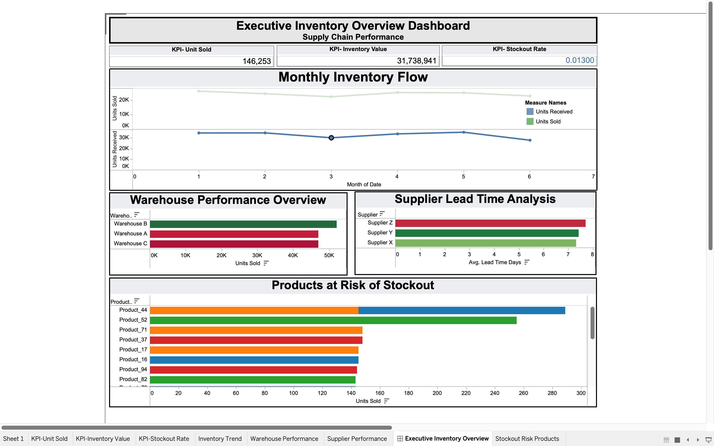

# 📊 Executive Inventory Dashboard (Tableau)

## 📌 Project Overview

This project presents an **executive-level inventory dashboard** built using Tableau. It provides insights into inventory performance, warehouse efficiency, and supplier delivery using interactive visualizations.

The goal is to support **data-driven decision-making** by identifying trends, risks, and operational bottlenecks in supply chain management.

---

## 📂 Dataset

**Data source:** simulated inventory data (2,000 rows) created for practice, with the same structure as my [Excel inventory project](https://github.com/sabazafar209-wq/Inventory_Data_Analysis). All figures and insights below describe this simulated data, not a real company.

Fields: date, product, category, warehouse, opening stock, units received, units sold, closing stock, stockout flag, supplier lead time, supplier, unit cost and unit price.

---

## 🎯 Objectives

* Monitor inventory movement (incoming vs outgoing)
* Identify products at risk of stockout
* Compare warehouse performance
* Analyze supplier lead time
* Provide insights for better inventory planning

---

## 🛠 Tools Used

* Tableau Desktop
* Excel (for dataset preparation)

---

## 📈 Key KPIs

* Total Units Sold
* Inventory Value
* Stockout Rate
* Inventory Turnover

---

## 📊 Dashboard Features

* KPI cards for quick performance overview
* Monthly inventory trend (Units Sold vs Units Received)
* Warehouse performance comparison
* Supplier lead time analysis
* Stockout risk identification (product-level)
* Interactive filters (Category, Warehouse, Supplier, Date)

---

## 🔍 Key Insights

* Some warehouses show high sales but also higher stockout rates
* Supplier delays impact inventory availability
* High-demand products are more likely to go out of stock
* Inventory flow imbalance observed in certain months

---

## 💡 Business Recommendations

* Improve supplier reliability for high lead-time vendors
* Maintain safety stock for high-demand products
* Optimize stock distribution across warehouses
* Monitor inventory trends regularly for better planning

---

## 📷 Dashboard Preview



More views: [monthly inventory flow](screenshots/02-monthly-inventory-flow.png) · [inventory flow](screenshots/03-inventory-flow.png) · [stockout-risk products](screenshots/04-stockout-risk-products.png) · [supplier insights](screenshots/05-supplier-insights.png) · [supplier lead-time delay](screenshots/06-supplier-lead-time-delay.png) · [inventory insights](screenshots/07-inventory-insights.png) · [analysis](screenshots/08-analysis.png) · [workbook view](screenshots/09-workbook-view.png)

---

## 📁 Files Included

```
inventory-tableau-dashboard/
├── executive-inventory-dashboard.twb    Tableau workbook
├── inventory_dataset_2000_rows_v2.csv   simulated dataset
├── screenshots/                         dashboard views
├── LICENSE
└── README.md
```

**To open the workbook:** keep the CSV in the same folder as the `.twb` file and open it in Tableau Desktop or Tableau Public. If Tableau asks for the data source, point it to `inventory_dataset_2000_rows_v2.csv`.

---

## 🚀 About This Project

This project demonstrates my ability to:

* Analyze supply chain data
* Build interactive dashboards
* Present insights for business decision-making

---

## 👩‍💻 Author

**Saba Zafar**
Data Analyst & Learning Analytics Researcher

* Portfolio: [sabazafar209-wq.github.io/sabazafar.github.io](https://sabazafar209-wq.github.io/sabazafar.github.io/)
* ORCID: [0009-0002-3922-176X](https://orcid.org/0009-0002-3922-176X)
* Email: sabazafar209@gmail.com

---

## 📄 License

Released under the [MIT License](LICENSE).
